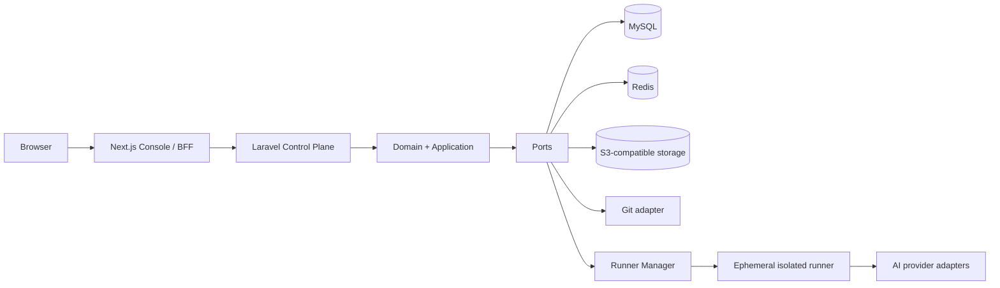
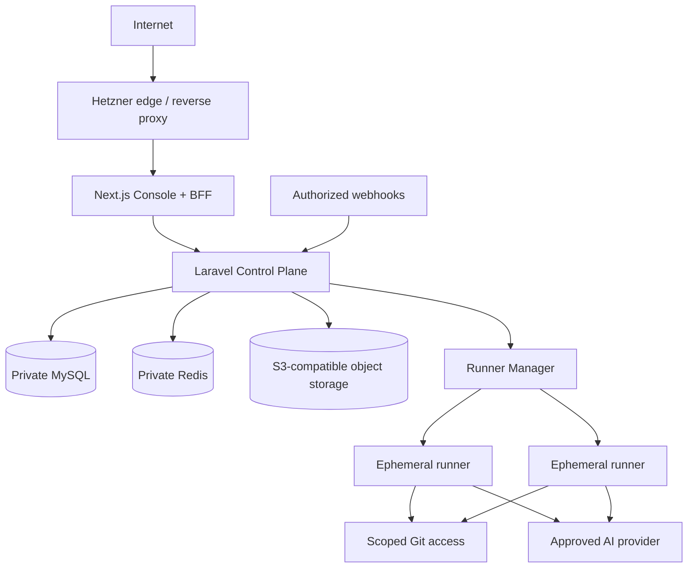

# Architecture Spine — SystemBuilder SaaS

## Design Paradigm

The Control Plane is a modular Laravel application with hexagonal boundaries. Domain and application modules own business rules; UI, persistence, queues, providers, Git, object storage, runners, Hetzner, and deployment are adapters. Next.js is Console/BFF only. Runner Manager is an independently deployable Execution Plane service.

The 0006 reference architecture is authoritative where it conflicts with the earlier Kernel-only PRD. The PRD’s governed-stage rules remain product constraints where compatible; its former scope exclusions do not narrow this initiative spine.



## Invariants & Rules

### AD-1 — Modular hexagonal Control Plane [ADOPTED]

- **Binds:** all Control Plane modules and adapters.
- **Prevents:** Stage, Workflow, Gate, tenancy, audit, or authorization rules in a UI, runner, provider, or infrastructure implementation.
- **Rule:** Business policies belong in Laravel `Domain`/`Application`; external systems are reached only through application-owned ports implemented by `Infrastructure`. Dependencies point inward only.

### AD-2 — Browser only reaches the Console BFF [ADOPTED]

- **Binds:** Console, BFF, browser sessions, Control Plane HTTP boundary.
- **Prevents:** browser exposure of internal credentials, direct runner/queue access, and BFF-owned business authority.
- **Rule:** The browser calls only Next.js BFF endpoints using opaque secure session cookies. BFF composes UI responses and calls Laravel server-to-server with a short-lived audience-bound principal delegation that Laravel verifies and reauthorizes for Tenant, Project, and action scope. A short-lived presigned object URL is the only direct-browser exception; it names one authorized object/action and exposes no internal service credential.

### AD-3 — Laravel owns governed state and authorization [ADOPTED]

- **Binds:** identity, tenancy, Projects, Workflows, policies, Gates, audit, and orchestration.
- **Prevents:** divergent workflow state, BFF authorization bypass, and Runner Manager deciding progression.
- **Rule:** Laravel alone creates or changes governed state. Only approved application commands append Ledger facts, authorize an Execution, accept a result, or close a Gate.

### AD-4 — Tenant scope is mandatory at every boundary [ADOPTED]

- **Binds:** MySQL, queries, BFF calls, object access, queue jobs, Git, and runner authorization.
- **Prevents:** IDOR, cross-tenant/project visibility, and implicit global records.
- **Rule:** The initial persistence topology is MySQL shared-schema with Tenant scope on every scoped record. Context is derived from authenticated membership, never an unverified browser value; repositories and policies fail closed without it. Execution tokens, object URLs, and Git credentials are bounded to one authorized execution and project. A future per-tenant database may change storage placement only, never these scope/authorization semantics.

### AD-5 — Workflows and governance are declarative, versioned, and append-oriented [ADOPTED]

- **Binds:** Workflows, Stage Contracts/Profiles, Gate/approval policy, Capability Matrix, Guardrails, Ledger, Baselines, and traceability.
- **Prevents:** hard-coded agent flows, destructive history, and a completed runner task being confused with an accepted outcome.
- **Rule:** A versioned workflow declares inputs, executor, allowed provider/model, outputs, reviewers, policies, gates, retries, and transitions. The initial lifecycle profile is `Idea → Discovery → Product Brief/Brainstorm → PRD → UX → Architecture → Epics → Stories → Development → Epic Validation → Retrospective → Delivery`, and declares the Story adversarial/security/readiness gate and the Development test/review/security/verification gate. Override and Formal Exception are distinct decisions: the first may accept only declared nonessential failure classes; the second is predeclared for one blocker and transition and never converts `BLOCKED` to `PASS`. Material facts append to the Ledger; accepted Baselines, artifacts, decisions, and revisions are never overwritten. A stage advances only through a declared guard and Exit Contract. While downstream impact is incomplete or failed, dependent authorization and closure remain ineligible.

### AD-6 — Sources of truth are separated by data class [ADOPTED]

- **Binds:** MySQL, Redis, object storage, Git, workspaces, logs, artifacts, and backups.
- **Prevents:** Redis or a runner workspace becoming durable truth, and durable data being stranded in a runner.
- **Rule:** MySQL stores governed metadata/audit state; Redis is cache/queue coordination only; S3-compatible storage holds artifacts, uploads, exports, and backups; Git is persistent truth for project code; runner workspaces are disposable. Accepted artifacts carry governed metadata and a durable reference or hash.

### AD-7 — Execution runs only in the isolated Execution Plane [ADOPTED]

- **Binds:** Runner Manager, queues, runners, BMAD installation, execution credentials, logs, and limits.
- **Prevents:** untrusted code beside Control Plane data, runner-to-runner access, and runners owning governance state.
- **Rule:** Laravel authorizes a scoped job; Runner Manager creates one rootless, resource-limited, ephemeral workspace/container and enforces concurrency quotas per Tenant and Project. A runner receives only its checkout, read-only versioned BMAD, short-lived execution/Git/provider credentials, approved context, and scoped Control Plane endpoints. It never receives MySQL, Redis, global S3, host Docker socket, application key, or another project path/token. Each retry is a new bounded attempt; output after expiry/revocation or after another attempt is accepted is quarantined. Laravel validates correlation and policy, then accepts, rejects, or quarantines candidates before governed state changes. Runner loss cannot change accepted state.

### AD-8 — Providers, credentials, and executors are independent adapters [ADOPTED]

- **Binds:** AI Provider Adapter, Credential Profile, Model Policy, Execution Adapter, Capability Matrix, and BMAD Adapter.
- **Prevents:** provider-specific domain logic, secret disclosure, and silent fallback.
- **Rule:** Credential, model policy, executor, observed capability, and usage/cost record are separate versioned records owned by the Control Plane. Encrypt credentials outside the database master secret; materialize them only as short-lived runner secrets; redact from prompts, stdout/stderr, logs, Ledger, Artifact, Evidence, and UI. The BFF/API receives only an authorized, sanitized Evidence presentation model; it never derives safety from raw evidence. An incompatible or unhomologated capability fails explicitly; no provider/model/executor substitution is implicit.

### AD-9 — Infrastructure separates public app, private data, and runner egress [ADOPTED]

- **Binds:** Hetzner deployment, edge, app/worker nodes, data services, Runner Pool, storage, and webhooks.
- **Prevents:** public MySQL/Redis, runner access to private data services, and hosts mixing untrusted workloads with Control Plane data.
- **Rule:** Deploy Console/BFF and Laravel behind the public edge; MySQL and Redis reside only on a private network; Laravel Queue/Horizon workers coordinate through Redis; Runner Manager/runners use separate hosts with controlled outbound access to approved AI, Git, package, and scoped Control Plane endpoints. Progress reaches the browser only through BFF-mediated SSE/WebSocket. Object access uses Control Plane mediation or expiring presigned URLs. Store encrypted backups outside the operational VM, test restore before production and periodically thereafter, and apply schema migrations as compatible, reviewed releases. Scale app nodes, workers, and runner hosts independently. Redis is replaceable coordination: apply security patches immediately and reassess its current GA support line at each quarterly platform update.

### AD-10 — Customer code delivery is adapter-mediated and separate from SaaS delivery [ADOPTED]

- **Binds:** Git Provider Adapter, Deployment Provider Adapter, project branches/commits, environment secrets, and Deployment Runs.
- **Prevents:** shared persistent workspaces, permanent production credentials in development runners, and deployment implementation leaking into workflow policy.
- **Rule:** A project uses an isolated Git repository and constrained per-execution branch/credential. An accepted code result records base commit and updates its expected ref by compare-and-swap; protected merge is permitted only after declared Gate checks. Deployment is a separate capability through a Deployment Provider adapter; its environments, secrets, approvals, rollout, health check, and rollback are governed independently of coding execution. Deploying SystemBuilder SaaS is a separate pipeline from deploying a customer project.

### AD-11 — The BMAD development route is a versioned workflow profile [ADOPTED]

- **Binds:** BMAD workflow profile, Readiness, recommendations, authorizations, Stage transitions, and Coding/Story entry.
- **Prevents:** agents or UI recommendations skipping required artifacts because an output merely exists.
- **Rule:** The initial mandatory BMAD profile declares and evaluates the ordered route `PRD → UX → Architecture → Project Context → Coding/Story`. Every recommendation, authorization, and transition is checked against its active profile revision. A missing, stale, or unvalidated prerequisite blocks progression; an exception is valid only when the profile predeclares, approves, audits, and scopes it to one transition.

### AD-12 — Project Constitution is controlled execution context [ADOPTED]

- **Binds:** project memory, ADRs, guardrails, conventions, dependency policy, runner context, and retrospective output.
- **Prevents:** agents receiving unbounded history or acting on stale/discarded decisions.
- **Rule:** Laravel stores a versioned Project Constitution containing only durable architecture, security, naming, guardrail, dependency, and prohibited-practice facts. A workflow selects the minimum relevant approved Constitution revision for an Execution; retrospective learnings become active context only through a governed revision.

### AD-13 — Async boundaries use durable dispatch and canonical envelopes [ADOPTED]

- **Binds:** Laravel commands, Redis jobs, runner callbacks, progress/usage events, and authorized webhooks.
- **Prevents:** a committed governed mutation without dispatch, duplicate or reordered result application, and spoofed/replayed webhook mutation.
- **Rule:** A state-changing Laravel transaction writes its Ledger/projection mutation and an outbox record atomically; a dispatcher publishes it after commit. Every asynchronous message carries immutable `event_id`, `event_type`, `schema_version`, `occurred_at`, `tenant_id`, `project_id`, `execution_id`, `correlation_id`, and per-execution `sequence`; consumers deduplicate by `event_id` and apply only valid sequence/state transitions. Webhooks verify source signature, timestamp/replay window, target scope, and idempotency before becoming candidates for the same intake path.

## Consistency Conventions

| Concern | Convention |
| --- | --- |
| Modules | Laravel: `Domain/<Context>`, `Application/<Context>`, `Infrastructure/<Adapter>`, `Http`. Next.js: `app`, `features`, `bff`, `server` for presentation/session/API-client only. |
| IDs, time, scope | External IDs are opaque; every command has server-derived Tenant/Project context; timestamps are UTC with actor/origin/correlation. |
| State mutation | Commands invoke use cases; material changes append Ledger events and update projections atomically. Consumers are idempotent by correlation ID. |
| Errors/logs | External errors are sanitized; structured logs carry permitted correlation/scope, never secrets or raw restricted Evidence. |
| Interfaces | Ports are versioned contracts; adapters return capability/compatibility results, never guesses or fallback. |
| UI accessibility | Console follows UX: shadcn/ui, WCAG 2.2 AA, pt-PT/pt-BR/en/es, critical desktop/laptop actions only, mobile consultation only. |

## Stack

| Name | Version |
| --- | --- |
| Next.js | 16.4.2 |
| Node.js LTS | 24.22.1 |
| React + React DOM | 19.3.0 |
| Laravel | 13.38.0 |
| PHP | 8.5.12 |
| MySQL LTS | 8.4.13 |
| Redis Open Source | 8.10.2 |
| Hetzner Cloud + S3-compatible Object Storage | verified 2026-10-21 |
| Laravel Queue + Horizon | bundled with Laravel 13.38.0 application seed |

## Structural Seed



```text
systembuilder/
  console/                    # Next.js Console and BFF; no domain policies
  control-plane/
    app/
      Domain/                 # tenancy, projects, workflows, executions, AI, audit, delivery
      Application/            # commands, queries, ports, transaction boundaries
      Infrastructure/         # MySQL, Redis, S3, Git, AI, runners, Hetzner adapters
      Http/                   # Laravel API/gateway adapters
  runner-manager/             # execution job validation and runner lifecycle
  contracts/                  # versioned BFF/API, runner, adapter, and event contracts
  infra/                      # Hetzner topology, network, build/deploy definitions
```

## Capability → Architecture Map

| Capability / Area | Lives in | Governed by |
| --- | --- | --- |
| Tenant, Project, membership, policies | Laravel Identity/Tenancy/Projects | AD-3, AD-4 |
| Stage Contract, Readiness, Gate, Baseline, impact | Laravel Workflow/Governance | AD-1, AD-3, AD-5 |
| Console and audit interaction | Next.js Console/BFF | AD-2, UI convention |
| BMAD, provider, execution compatibility | Adapter modules + Capability Matrix | AD-5, AD-8 |
| Authorized agent/code execution | Runner Manager + ephemeral runners | AD-7, AD-9 |
| Ledger, artifacts, Evidence, traceability | MySQL + object storage + Git | AD-5, AD-6 |
| Project code and customer delivery | Git and Deployment Provider adapters | AD-6, AD-10 |
| SaaS operation and scale | Hetzner edge/app/data/runner topology | AD-9 |

## Deferred

- Identity provider, MFA enforcement, and exact RBAC/ABAC model: decide before external/customer onboarding; Laravel remains final authorization authority.
- Canonical external ID format and exact entity cardinalities: decide with the first data-model migration; scope/correlation/immutability rules already bind.
- Runner protocol, queue payload schema, retry/backoff values, and idempotency-key encoding: decide in the Runner Manager contract before its first implementation.
- First BMAD tag/commit, skill inventory, provider/executor combination, and Contract Test fixtures: decide before homologating the first executable Stage Profile.
- Rootless OCI runtime and host image: select one supported runtime in the Runner Manager deployment manifest before runner build; prove AD-7 controls in its conformance suite. This local implementation choice must not alter the Runner Manager contract.
- CI/CD product, IaC tool, Hetzner region/VM sizing, exact firewall rules, monitoring vendor, and SLOs: decide before production; topology and separation already bind.
- Hetzner region/residency and Object Storage disaster-recovery posture: decide and evidence them before the first production Tenant.
- Retention durations, deletion/export workflow, and enterprise dedicated tenancy: decide with compliance/commercial requirements without weakening append-only audit or scoped access.
- gVisor/Kata/microVM hardening, egress proxy, dedicated tenant pools, and database-per-tenant: adopt when baseline runner threat model/customer risk requires it.
- Billing provider and plans: no domain rule depends on a billing implementation until Product selects one.
- Interaction-mode taxonomy: reconcile the UX `Guided`/`Advanced` model with the 0005 `Guided`/`Collaborative`/`Expert` taxonomy in the PRD update; the chosen policy must remain a versioned Project setting independent of autonomy authority.
